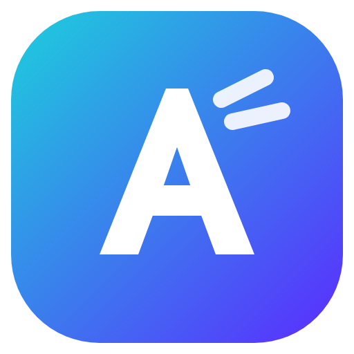

# AsturCut — Editor de vídeo para PC

Editor de vídeo para **Windows**, **Linux (Ubuntu, Zorin OS, Linux Mint, Pop!_OS…)** e **celular Android** no estilo CapCut / Premiere, com tema escuro e destaque ciano por padrão e tudo personalizável.



## Baixar o instalador

O instalador do Windows é gerado automaticamente pelo GitHub Actions a cada push:

1. Abra a aba **Actions** do repositório e entre na execução mais recente de **"Gerar instalador"**.
2. Em **Artifacts**, baixe **AsturCut-Instalador-Windows** (é um `.zip` com o `AsturCut-Setup-x.y.z.exe` dentro).
3. Execute o instalador. Você pode escolher a pasta de instalação, e ele cria atalhos na Área de Trabalho e no Menu Iniciar.

> Para gerar uma **Release** com o `.exe` anexado, crie uma tag `v1.0.0` (por exemplo) e envie: `git tag v1.0.0 && git push origin v1.0.0`.

O instalador tem visual moderno e escuro: na primeira tela você escolhe o idioma (**Português, English ou Español**), a pasta e se quer atalho na área de trabalho, e clica em **Instalar agora**. No final, o botão **Abrir o AsturCut** já abre o editor. O AsturCut abre no idioma escolhido, e dá para trocar depois na tela inicial ou em *Personalizar → Aparência*.

Como o instalador não é assinado digitalmente, o Windows SmartScreen pode mostrar um aviso. Clique em **Mais informações → Executar assim mesmo**.

## Linux: Ubuntu / Zorin OS

Na página da **Release** (ou em *Actions → Artifacts → AsturCut-Linux*) baixe:

- **`AsturCut-x.y.z-amd64.deb`** — recomendado para Zorin OS, Ubuntu, Linux Mint e Pop!_OS. Dê dois cliques no arquivo e clique em **Instalar** (abre a loja de aplicativos do sistema). Ou pelo terminal:

```bash
sudo apt install ./AsturCut-1.3.0-amd64.deb
```

  Depois é só procurar **AsturCut** no menu de aplicativos. Para atualizar, instale o `.deb` novo por cima. Para remover:

```bash
sudo apt remove asturcut
```

- **`AsturCut-x.y.z-x86_64.AppImage`** — funciona em qualquer distro sem instalar. Clique com o botão direito → *Propriedades → Permitir executar como programa* e abra. No Ubuntu 22.04/Zorin 17 pode ser preciso instalar `libfuse2` (`sudo apt install libfuse2`).

No Linux o AsturCut abre no idioma do sistema (dá para trocar na tela inicial). As preferências ficam em `~/.config/AsturCut` e as gravações em `~/Documentos/AsturCut/Gravações`. Na gravação de tela pelo Wayland, o próprio sistema pode pedir para você escolher a tela.

## Celular Android (APK)

Na página da **Release** (ou em *Actions → Artifacts → AsturCut-Android*) baixe o **`AsturCut-x.y.z.apk`** (~4 MB) no celular e toque nele para instalar. Na primeira vez o Android pede para **permitir instalar apps desta fonte** (Chrome ou Arquivos) — é só permitir. Precisa de Android 10 ou mais novo.

- Interface de celular: exibidor em cima, linha do tempo no meio e ferramentas embaixo (Mídia, Áudio, Texto, Stickers, Efeitos, Filtros, Transições, Animações e Editar). Pinça na linha do tempo dá zoom, toque duplo no clipe abre as propriedades e o botão voltar fecha as gavetas.
- **Importar**: escolha vídeos, fotos e músicas da galeria — o AsturCut guarda uma cópia para o projeto continuar funcionando.
- **Exportar**: gera **MP4** no próprio celular (usa o codificador de vídeo do aparelho) e salva na galeria em *Filmes/AsturCut*, com botões **Assistir** e **Compartilhar** (WhatsApp, Instagram, Drive…).
- Legendas automáticas, remover fundo e tirar silêncios também funcionam; as bibliotecas de IA são baixadas só na primeira vez que você usar (por isso o APK fica leve).
- Gravação de tela é só no PC.

Atualizar: o app avisa quando sai versão nova; baixe o APK novo e instale por cima (os projetos continuam).

> Assinatura do APK: o GitHub Actions gera uma chave uma vez e guarda no cache para as próximas versões instalarem por cima. Para deixar a chave permanente, crie os segredos `ANDROID_KEYSTORE_B64` (arquivo .jks em base64), `ANDROID_KEYSTORE_PASSWORD` e `ANDROID_KEY_ALIAS` em *Settings → Secrets and variables → Actions*.

## Como atualizar

O AsturCut avisa sozinho quando sai uma versão nova: aparece **"Nova atualização disponível!"** com o botão **Atualizar agora**, que baixa o instalador mais recente. Também dá para verificar em *Menu → Verificar atualizações...*.

Para atualizar, é só abrir o instalador novo. Ele instala por cima e mantém seus projetos, preferências e fontes.

### Publicar uma versão nova (para quem desenvolve)

1. Mude a versão em `package.json` (por exemplo, `1.3.0`), faça o commit e envie.
2. No GitHub, abra **Actions → Gerar instalador → Run workflow**, deixe marcado **"Publicar uma Release"** e clique em **Run workflow**.

Em poucos minutos sai a **Release** `v1.3.0` com o instalador `.exe` (Windows) e os pacotes `.deb` e `.AppImage` (Linux), e todos que têm o AsturCut veem o aviso de atualização. Enviar uma tag `v1.3.0` também funciona.

## Recursos

**Novidades da 1.4 — ferramentas profissionais**
- **Cor estilo Lumetri**: rodas de cor (sombras, meios-tons, realces), curvas RGB e por canal, **LUTs .cube** com intensidade, antes/depois e **scopes** (forma de onda, vetorscópio e histograma) — também funciona em camadas de ajuste (clipes de filtro)
- **Máscaras** retangulares e elípticas em qualquer clipe: posição, tamanho, rotação, suavização, expansão, opacidade e inverter
- **Ferramentas de edição do Premiere**: Ripple (B), Rolante (N), Alongar taxa (R), Slip (Y), Slide (U) e Lâmina (C)
- **Detectar cenas**: corta o vídeo sozinho em cada troca de cena, no quadro exato
- **Ducking automático** (abaixa a música quando há fala) e **crossfade de áudio** nas emendas
- **Congelar quadro** (Shift+F), **Histórico de ações** (Ctrl+H) e **Fila de exportação** (várias versões em sequência)

**Novidades da 1.3**
- **Legendas automáticas**: o AsturCut ouve a fala e cria as legendas sozinho (Whisper rodando no seu PC, nada vai para a internet). Estilos Clássica, Destaque (karaokê), Pop, Com fundo, Neon e Simples. O modelo de IA é baixado só na primeira vez.
- **Remover fundo**: recorte de pessoa com IA (sem tela verde) e chroma key para tela verde/azul, com conta-gotas, suavidade e remoção de reflexo
- **Exportação rápida**: áudio mixado na hora e vídeo codificado pela placa de vídeo (até ~2,5x mais rápido que o tempo real) + predefinições (YouTube 1080p/4K, Reels/TikTok/Shorts, Instagram, WhatsApp, GIF, MP3) e predefinições salvas por você
- **Gravar tela e webcam** com microfone (narração) e som do computador; barra flutuante com Pausar/Parar (Ctrl+Shift+F9); os arquivos vão para Documentos\AsturCut\Gravações e entram direto na linha do tempo
- **Tirar silêncios** automaticamente, com prévia da forma de onda, limiar, silêncio mínimo e margem
- Tela de abertura "AsturCut preparando..." enquanto o editor carrega

**Tela inicial**
- Botão "Criar projeto" em destaque, com atalhos de proporção (YouTube, Reels/TikTok, Instagram, Feed)
- Começar rápido: abrir projeto, importar mídia, intro animada, slideshow de fotos
- Projetos recentes com miniatura, duração e data, e busca na aba Projetos
- 6 modelos prontos: intro animada, slideshow de fotos, Reels com legenda, abertura de canal, aniversário e citação
- Idiomas: Português, English e Español

**Edição**
- Linha do tempo com várias trilhas (vídeo/camadas e áudio), trilha principal, bloquear, ocultar e silenciar trilhas
- Arrastar e soltar, aparar pelas bordas, dividir (Ctrl+B / S), ferramenta lâmina, excluir à esquerda e à direita (Q/W)
- Encaixe automático (snap), trilha principal magnética, marcadores, zoom com Ctrl+roda
- Desfazer e refazer ilimitados, copiar, colar e duplicar, separar o áudio do vídeo
- Velocidade (0,1x a 10x), volume até 300%, fade in e fade out
- Corte (crop), modos de ajuste (conter, preencher, esticar), 16 modos de mistura
- Proporções 16:9, 9:16, 1:1, 4:3, 4:5, 21:9 e original, com fundo em cor ou desfocado

**Ferramentas profissionais** (inspiradas no fluxo do Premiere)
- Pastas de mídia (bins), ordenação por nome/tipo/duração e modo lista ou grade
- Visualizador de origem: marque Entrada (I) e Saída (O) e insira só o trecho, só o vídeo ou só o áudio
- Rótulos de cor nos clipes (L), exclusão com ripple (Shift+Delete), selecionar e apagar espaços vazios
- Ferramenta "selecionar à frente" (A), vincular/desvincular áudio e vídeo, solo de trilha
- Keyframes em posição, escala, rotação, opacidade e volume, com suavização (ease in/out)
- Velocidade/duração (Ctrl+R) e ganho de áudio em dB (G)
- Mixer de áudio por trilha: equalizador com curva, compressor, limitador, redução de ruído, pan, volume e medidores
- Cor: realces, sombras, brancos e pretos, conta-gotas de balanço de branco, antes/depois e aplicar a toda a mídia
- Copiar e colar atributos (Ctrl+Alt+V), marcas de Entrada/Saída na timeline e exportar só esse intervalo
- Maximizar o painel sob o mouse (tecla `), atalhos totalmente remapeáveis, resolução personalizada e layouts salvos

**Biblioteca grátis**
- **50 fontes** do Google Fonts embutidas, com favoritas. Também dá para importar suas próprias fontes `.ttf`/`.otf`
- **46 efeitos**: VHS, glitch, aberração cromática, filme antigo, neon, duotone, chuva, neve, confete, corações, bokeh, tremor, zoom, flash e outros
- **28 filtros** de cor (Cinema, Teal & Orange, Vintage, Noir, Cyberpunk…) com controle de intensidade
- **27 transições** (dissolver, empurrar, cortina, círculo, relógio, zoom, girar, glitch, pixelizar…)
- **Animações** de entrada, saída e loop (incluindo máquina de escrever para textos)
- **24 modelos de texto** (neon, contorno, quadrinhos, gamer, cinema, legenda…) com contorno, sombra, fundo e brilho
- **Stickers**: mais de 180 emojis e 16 formas (setas, balões, botão Inscrever-se, lower third, barra de progresso…)
- **Áudio**: 6 músicas e 23 efeitos sonoros gerados pelo próprio app, todos livres de direitos autorais
- **Fundos**: cores sólidas, gradientes e padrões
- Painel **Ajuste**: brilho, contraste, exposição, saturação, temperatura, matiz, tonalidade, nitidez, desfoque e vinheta

**Exibidor (prévia)**
- Mova, redimensione e gire os clipes direto no vídeo, com guias de centro
- Grade de composição (regra dos terços), qualidade da prévia, tela cheia

**Personalização** (botão *Personalizar* ou `Ctrl+,`)
- 10 temas prontos e cores livres para destaque, fundo, painéis, bordas e texto. Dá para exportar e importar temas
- Fonte da interface, tamanho da interface (70% a 140%), arredondamento e espaçamento
- Layout: arraste as bordas para redimensionar e arraste o título de um painel (⋮⋮) sobre outro para trocar de lugar. Há 7 layouts prontos (exibidor grande, timeline grande, invertido, modo foco…)
- Preferências do editor: durações padrão, snap, magnetismo, salvamento automático

**Projetos e exportação**
- Projetos salvos em `.astur`, com lista de recentes, salvamento automático e recuperação de projeto não salvo
- Exportação em MP4 (H.264), WebM, MOV, GIF ou somente áudio MP3. Resoluções de 480p a 4K, 24 a 60 fps

## Rodar a partir do código

Requisitos: [Node.js](https://nodejs.org) 20 ou mais novo.

```bash
npm install
```

```bash
npm start
```

## Gerar os pacotes no Linux

```bash
npm install
npx electron-builder --linux deb AppImage
```

Os arquivos ficam em `dist/`.

## Gerar o APK (Android)

Precisa do Node.js 22, Java 21 e Android SDK:

```bash
npm install
node scripts/build-mobile.js
npx cap sync android
cd android && ./gradlew assembleRelease
```

O APK fica em `android/app/build/outputs/apk/release/`.

## Gerar o instalador no seu PC (Windows)

```bash
npm run dist
```

O instalador fica em `dist/AsturCut-Setup-<versão>.exe`.

## Estrutura

```
src/main/        processo principal do Electron (janela, diálogos, protocolo de mídia, FFmpeg)
src/renderer/    interface
  js/store.js        estado do projeto, desfazer/refazer, operações de edição
  js/compositor.js   motor de renderização (prévia e exportação)
  js/timeline.js     linha do tempo
  js/player.js       exibidor e reprodução
  js/inspector.js    painel de propriedades
  js/library.js      biblioteca (mídia, áudio, texto, stickers, efeitos…)
  js/lib/            efeitos, filtros, transições, animações, stickers, textos, sons
  js/settings.js     temas e preferências
  js/layout.js       layout personalizável
scripts/prepare-fonts.js  copia as fontes grátis (roda no npm install)
scripts/build-mobile.js   monta a versão de celular (mobile/www) para o Capacitor
android/                  projeto Android (Capacitor + plugin nativo AsturNative)
scripts/prepare-vendor.js copia as bibliotecas de IA local (Transformers.js/ONNX e MediaPipe) para src/renderer/vendor
electron-builder.yml      configuração do instalador (NSIS)
```

## Licenças de terceiros

- Fontes: Google Fonts via Fontsource (SIL Open Font License / Apache 2.0)
- FFmpeg via `ffmpeg-static` (LGPL/GPL)
- Electron (MIT)
- Transformers.js e ONNX Runtime Web (Apache 2.0 / MIT); modelos Whisper (MIT) baixados do Hugging Face na primeira vez
- MediaPipe Tasks Vision e o modelo Selfie Segmenter (Apache 2.0)
